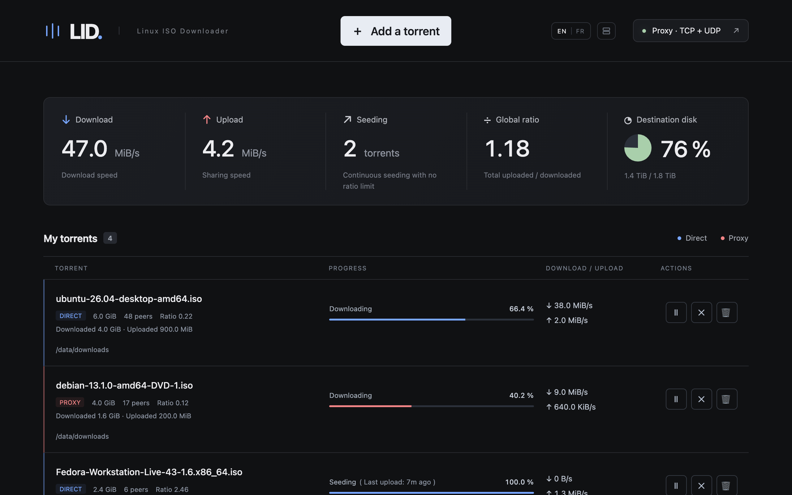
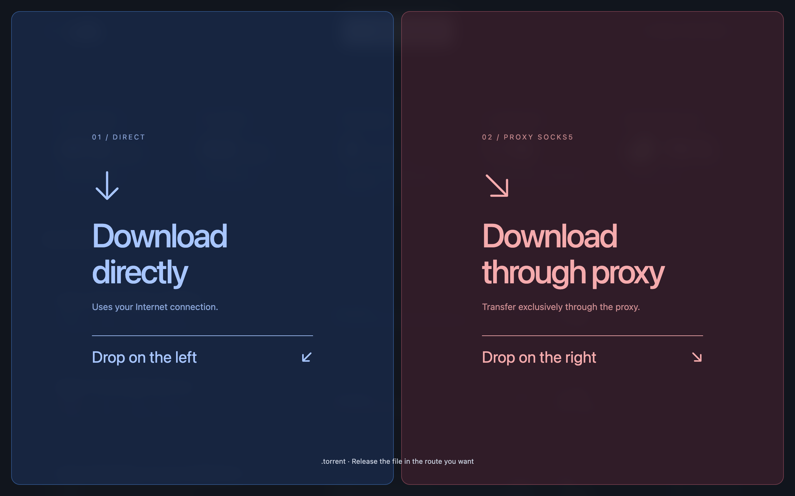
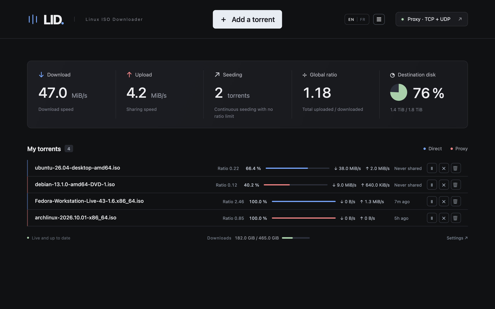

# LID — Linux ISO Downloader

LID is a self-hosted BitTorrent client for a home server. It runs in the
background, keeps a clean web dashboard on your local network, and lets you
choose a route for every torrent: **Direct** over your own connection, or
**Proxy** through a SOCKS5 server, with no fallback from one to the other.



## Features

- **Two isolated routes.** Direct and proxy torrents run in separate
  libtorrent sessions. Proxy mode is fail-closed: TCP, UDP (when the proxy
  supports it), DNS and DHT bootstrap all go through the proxy, and a proxy
  torrent stops rather than leaking when the proxy is down.
- **Add torrents your way.** Drop `.torrent` files on the left (direct) or
  right (proxy) half of the window, paste a magnet link, or send them from
  Chrome with the [LID extension](extension/README.md).
- **Clear dashboard.** Live download and upload speed, seeding count, global
  ratio and destination disk usage at a glance; per-torrent progress, peers,
  ratio and last upload. A compact view fits each torrent on one line.
- **Storage that stays tidy.** Downloads land in a working folder, then move
  to an optional final folder (another disk, a NAS share) once complete,
  verified before the copy is released. Completed torrents sit directly in
  the final folder, identical copies are adopted instead of duplicated, and
  an interrupted move recovers on restart.
- **Seeds by default.** Completed torrents keep seeding with no ratio limit;
  one with no upload for 7 days is removed from the list, its files kept.
- **Safe removal.** Remove a torrent and keep its files, or delete it with
  exactly the files it owns.
- **English and French**, switchable from the header.





## Install and run

LID runs on Linux or macOS with Python 3.12.

```sh
git clone https://github.com/J4GL/LID.git
cd LID
./run.sh
```

`run.sh` creates `.venv`, installs the pinned dependencies (libtorrent 2.1
binary wheel included), checks the configured ports, then starts LID. When
Python 3.12 is missing it installs it with [uv](https://docs.astral.sh/uv/)
if available, or tells you how to get it. Stop LID with `Ctrl+C`.

Open `http://<server-ip>:8000` from any device on your network. On first
launch a setup screen asks for:

1. **Storage** — the downloads folder, the optional final folder, and where
   LID keeps its internal data.
2. **Connections** — web address and port, the direct port and UPnP, and the
   SOCKS5 proxy (host, port, credentials, UDP mode) with a built-in test.
3. **Performance** — bandwidth limits and connection counts.

The torrent engines stay stopped until setup is saved. Every setting can be
changed later from **Settings** in the footer; the result is written to
`config.yaml` (see [config.example.yaml](config.example.yaml)).

## Run as a service (Linux, systemd)

```sh
sudo ./install-service.sh
```

installs and starts `lid.service` as your user. Without root access, use a
user service instead:

```sh
loginctl enable-linger "$USER"
./install-service.sh --user
```

To pull the latest commits of the checked-out branch and restart the service:

```sh
./upgrade.sh          # or ./upgrade.sh --user
```

The upgrade stops on a diverged checkout without touching your data, does
nothing when already up to date, and never leaves the service stopped.

### Older libraries

Libraries created before the flat final folder used
`<final>/<route>/<infohash>/`. With the service stopped, preview then apply
the one-time migration:

```sh
.venv/bin/python -m app.migrate          # dry run: prints the plan only
.venv/bin/python -m app.migrate --apply
```

## Security

LID is meant for a trusted local network and has no login. It only answers
when reached through `localhost` or a private IP address (which blocks DNS
rebinding), every state-changing request needs a per-session token, and pages
ship with a strict Content-Security-Policy. Do not expose its port to the
Internet.

## Development

Behaviour is specified in [SPEC/](SPEC/README.md): one spec per observable
behaviour, each naming the automated test that proves it.

```sh
.venv/bin/python -m pip install -r requirements-dev.txt
.venv/bin/python -m pytest -q
node --test tests/*.test.mjs
```

Warnings are errors (`pytest.ini`). Dashboard end-to-end tests drive the real
app with the `obscura` headless browser, which must be on `PATH` (or set
`OBSCURA`). Regenerate the screenshots above with:

```sh
.venv/bin/python docs/screenshots/capture.py
```

It serves demo data through the real dashboard and captures it with headless
Chrome (set `CHROME` if it is not found).

## License

[CC0 1.0 Universal](LICENSE).
